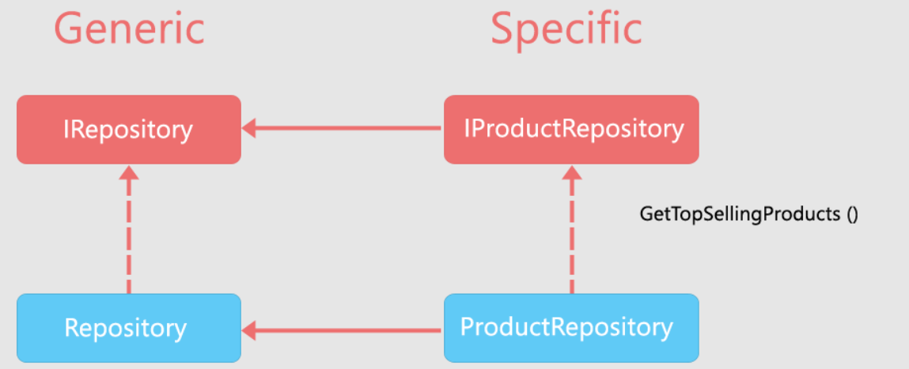

# Data Access Layer

The Data Access Layer (DAL) is the part of a web application that manages access to data. Its main job is to provide an interface between the application code and the database, hiding the complexity of the database and of the communication with it. The DAL usually provides a set of methods to create, read, update and delete data. This way, the rest of the application code does not have to deal with the technical details of the database.

## The Repository pattern

Repositories are components that encapsulate the data access logic. Centralizing this functionality makes the code easier to maintain and decouples the infrastructure and/or the technology used to access the database (the ORM) from the rest of the application.

The CodeArchitects.Platform.Data library defines the generic `IRepository` interface, which models the pattern just described.

```c#
public interface IRepository<TEntity, TKey>
  where TEntity : class
  where TKey : IEquatable<TKey>
{
  Task<TEntity?> FindAsync(TKey key, CancellationToken cancellationToken = default);
  Task<TEntity?> FindAsync(TKey key, IncludeAction<TEntity> includeAction, CancellationToken cancellationToken = default);
  Task InsertAsync(TEntity entity, CancellationToken cancellationToken = default);
  Task UpdateAsync(TEntity entity, CancellationToken cancellationToken = default);
  Task UpsertAsync(TEntity entity, CancellationToken cancellationToken = default);
  Task RemoveAsync(TEntity entity, CancellationToken cancellationToken = default);
  Task RemoveAsync(TKey key, CancellationToken cancellationToken = default);
}
```

Here `TEntity` is the type of entity the repository manages and `TKey` is the type of the entity's primary key.
This interface defines the most common data access operations; in particular:

- `FindAsync` looks up the entity by primary key.
- `InsertAsync` inserts a new entity into the database.
- `UpdateAsync` updates the values of an existing entity.
- `UpsertAsync` updates the entity's data if it already exists in the database, and inserts it otherwise.
- `RemoveAsync` removes an entity from the database.

Although these are the most common operations (CRUD), you very often need specialized operations (both reads and writes) for a particular entity type. For this reason, this interface is meant to be extended by specialized per-entity interfaces that, besides closing the generic types of the base interface, define methods representing those specialized operations, so that they are centralized, isolated from the rest of the application logic and grouped by meaning. This approach is known as the generic Repository pattern.

For example, consider an entity called `Product`, whose primary key is of type `Guid`.

```c#
public class Product
{
  public Guid Id { get; set; }
  public decimal Price { get; set; }
  public int SaleCount { get; set; }
}
```

We define a specialized interface for `Product` that extends the generic `IRepository<TEntity, TKey>` and defines a method to retrieve the best-selling products.

```c#
using CodeArchitects.Platform.Data;

public interface IProductRepository : IRepository<Product, Guid>
{
  Task<IEnumerable<Product>> GetTopSellingProductsAsync(int count, CancellationToken cancellationToken = default);
}
```

The `GetTopSellingProducts` method retrieves the top N (the `count` parameter) best-selling products; other specialized methods can be defined in the same way, and the parts of the application that use `IProductRepository` can access these specialized methods through the repository instance, in addition to the methods defined by the generic base interface.

## Implementing the Repository pattern

The repository interface reveals neither the database provider nor the ORM used to access it: these are implementation details, used by the classes that implement the methods.

Three implementations of the repository (and of the rest of the DAL) are currently available:

- CodeArchitects.Platform.Data.EntityFrameworkCore: DAL implementation based on Entity Framework Core 7.
- CodeArchitects.Platform.Data.AdoNet: DAL implementation that uses ADO.NET directly, typically used together with Dapper.
- CodeArchitects.Platform.Data.MongoDB: DAL implementation for MongoDB, based on the official MongoDB .NET driver (see [DAL with MongoDB](mongodb.md)).

> Note: Entity Framework Core 7 requires .NET 6 or later. For .NET Core 3.1 and .NET 5 projects, there is a CodeArchitects.Platform.Data.EntityFrameworkCore package that uses Entity Framework Core 5 and is compatible with .NET Core 3.1 and later.

These libraries provide the implementation of `IRepository<TEntity, TKey>`, which can be used as the base class for specialized repositories. For example, for `IProductRepository` the structure is as follows:



Let's see how to implement `IProductRepository` with Entity Framework Core, using `EFCoreRepository<TEntity, TKey>` as the base class.

```c#
using CodeArchitects.Platform.Data.EntityFrameworkCore;

public class ProductRepository : EFCoreRepository<Product, Guid>, IProductRepository
{
  public ProductRepository(IDataContext context)
    : base(context)
  {
  }

  public async Task<IEnumerable<Product>> GetTopSellingProductsAsync(int count, CancellationToken cancellationToken = default)
  {
    return await Entities
      .OrderBy(x => x.SaleCount)
      .Take(count)
      .ToListAsync(cancellationToken);
  }
}
```

The `EFCoreRepository` class exposes a protected property called `Entities`, which is the `DbSet<TEntity>` (`DbSet<Product>` in this case). Through the `DbSet` you can perform every operation on the `Product` entity that Entity Framework Core allows. `EFCoreRepository` also exposes the `DbContext` instance used by the application through the protected `DbContext` property. Finally, the constructor requires an instance of the `IDataContext` interface which, besides holding the reference to the application's `DbContext`, implements the generic repository methods in a form that can be typed for any entity (for example `FindAsync<TEntity, TKey>`), so you can use the base methods of other repositories without injecting the base repository; this is useful when a repository exposes access methods for a whole aggregate rather than a single entity. This object is available through the protected `Context` property of the base class.

The implementation with ADO.NET (and Dapper) is structurally very similar, but the query has to be written by hand or with some other SQL generation tool (for example SqlKata).

```c#
using CodeArchitects.Platform.Data.AdoNet;

public class ProductRepository : AdoNetRepository<Product, Guid>, IProductRepository
{
  public ProductRepository(IDataContext context)
    : base(context)
  {
  }

  public async Task<IEnumerable<Product>> GetTopSellingProductsAsync(int count, CancellationToken cancellationToken = default)
  {
    const string query = "SELECT [Id], [Price], [SaleCount] FROM [Products] ORDER BY [SaleCount] LIMIT @count";
    return await Connection.QueryAsync<Product>(query, new { count });
  }
}
```

In this case, the `AdoNetRepository` class exposes a protected property called `Connection` (of type `IDbConnection`) used to run queries. Here too there is an `IDataContext` interface that, as in the Entity Framework Core implementation, exposes the generic CRUD methods and the connection instance.

## The Unit of Work pattern

The Unit of Work pattern groups changes made to the database into a single operation (the unit of work), and is commonly used together with the Repository pattern.

The CodeArchitects.Platform.Data library defines the `IUnitOfWork` interface:

```c#
public interface IUnitOfWork : IAsyncDisposable
{
  Task SaveAsync(CancellationToken cancellationToken = default);
}
```

The only method exposed by this interface is `SaveAsync`, which commits all the changes made within the unit of work.

There are two ways to create a unit of work. The first is to create the `IUnitOfWork` instance explicitly with the `IUnitOfWorkManager` interface:

```c#
public interface IUnitOfWorkManager
{
  IUnitOfWork Begin(CancellationToken cancellationToken = default);
  IUnitOfWork Begin(bool autoSave, CancellationToken cancellationToken = default);
}
```

This interface defines the `Begin` method, which creates a new unit of work; since `IUnitOfWork` implements `IAsyncDisposable`, this method should be used with an `await using` statement.

```c#
public class ShopService
{
  private readonly IUnitOfWorkManager _uowManager;
  private readonly IProductRepository _productRepo;
  private readonly ICartRepository _cartRepo;

  public MyService(IUnitOfWorkManager uowManager, IProductRepository productRepo, ICartRepository cartRepo)
  {
    _uowManager = uowManager;
    _productRepo = productRepo;
    _cartRepo = cartRepo;
  }

  public async Task FinalizeCartAsync(Cart cart, CancellationToken cancellationToken = default)
  {
    await using (IUnitOfWork uow = _uowManager.Begin(cancellationToken))
    {
      await _cartRepo.SetStatusToCompletedAsync(cart.Id, cancellationToken);
      foreach (Product product in cart.Products)
      {
        await _productRepo.IncrementSaleCountAsync(product.Id);
      }

      await uow.SaveAsync(cancellationToken);
    }
  }
}
```

Here, within the unit of work (the scope defined by the `await using` statement), operations on several entities take place (on the cart and on the products it contains), and they are all executed together when `SaveAsync` is called. This way, all the operations either complete together or fail together, which prevents the database from being left in an inconsistent state (for example, a cart marked as completed while the sale count of its products has not been incremented).

By default, you must call `SaveAsync` when you want to commit the changes, but there is an overload of `Begin` that accepts a `boolean` `autoSave` parameter which, when set to `true`, automatically calls `SaveAsync` when the scope opened by `Begin` ends.

```c#
await using (IUnitOfWork uow = _uowManager.Begin(autoSave: true, cancellationToken))
{
  await _cartRepo.SetStatusToCompletedAsync(cart.Id, cancellationToken);
  foreach (Product product in cart.Products)
  {
    await _productRepo.IncrementSaleCountAsync(product.Id);
  }
}
```

> Note: `SaveAsync` can be called more than once within the same scope.

The second way to use the `IUnitOfWork` interface is to request an instance directly through Dependency Injection. In this case, a single unit of work is created for the whole execution context (in other words, `IUnitOfWork` is registered with `ServiceLifetime.Scoped`).

```c#
public class ShopService
{
  private readonly IUnitOfWork _uow;
  private readonly IProductRepository _productRepo;
  private readonly ICartRepository _cartRepo;

  public MyService(IUnitOfWork uow, IProductRepository productRepo, ICartRepository cartRepo)
  {
    _uow = uow;
    _productRepo = productRepo;
    _cartRepo = cartRepo;
  }

  public async Task FinalizeCartAsync(Cart cart, CancellationToken cancellationToken = default)
  {
    await _cartRepo.SetStatusToCompletedAsync(cart.Id, cancellationToken);
    foreach (Product product in cart.Products)
    {
      await _productRepo.IncrementSaleCountAsync(product.Id);
    }
    
    await _uow.SaveAsync(cancellationToken);
  }
}
```

## Associations and aggregates

In the previous example, the `Cart` and `Product` entities were managed by two different repositories (`ICartRepository` and `IProductRepository`, respectively). Domain Driven Design (DDD) introduces the concept of an aggregate: a set of related entities treated as a single unit, in which one entity, called the Aggregate Root, gives access to the whole aggregate.

In this case, we can build an aggregate made of `Cart` and `Product` linked by a one-to-many relationship (a cart contains many products), with `Cart` as the Aggregate Root. To do so, besides having at least one navigation property between the two entities (for example, `Cart.Products` or `Product.Cart`), the Data Access Layer must be told to take these relationships into account when reading and writing.

Of course, two related entities (and therefore with at least one navigation property) are not necessarily part of the same aggregate. In general, there are two kinds of association.

1. Intra-aggregate: the two entities are part of the same aggregate and the second one depends hierarchically on the first
2. Inter-aggregate: the two entities are not part of the same aggregate, or they are hierarchically independent

As for multiplicity, the following relationship types are supported:

- One-to-one: both intra-aggregate and inter-aggregate
- One-to-many: both intra-aggregate and inter-aggregate
- Many-to-many: inter-aggregate only, since the entities are always hierarchically independent

### Reading

For reads, there is no difference between the two kinds of association, because the `FindAsync` method has two overloads: the first accepts only the entity id and does not load the navigation properties, while the second accepts a function that specifies, fluently, the navigation properties to include in the query.

```cs
ICartRepository repo = ...;

Cart cart1 = await repo.FindAsync(id1); // cart1.Products is null
Cart cart2 = await repo.FindAsync(id2, _ => _
  .Include(cart => cart.Products)); // cart2.Products is not null
```

This behavior is the same whether the association is intra-aggregate or inter-aggregate.

### Writing

For writes, InsertAsync and UpdateAsync behave differently depending on the kind of association.

Since the Aggregate Root is the object through which the whole aggregate is accessed, an Insert on the Aggregate Root inserts all the navigation properties and sub-properties that belong to the aggregate (intra-aggregate). Navigation properties that do not belong to the aggregate (inter-aggregate) are not inserted; those entities are assumed to already exist, and only the database representation of the inter-aggregate relationship is created. This means that foreign keys and rows in the association tables (junction tables, for many-to-many relationships) are filled in. Update works exactly the same way. Delete, on the other hand, works like Find; nevertheless, if you want all the entities of the aggregate to be deleted in cascade when the Aggregate Root is deleted, set the delete behavior at the database level.

### Configuration

To configure associations, see the corresponding sections of the documentation of the two providers:

- [Entity Framework Core](efcore.md#associations)
- [ADO.NET](adonet.md#associations)

## Seeding

To seed the database, extend the `DataSeed` base class:

```cs
public class ApplicationDataSeed : DataSeed
{
  public void Seed(ISeeder seeder)
  {
    seeder.Seed(
      new Product { ... },
      new Product { ... },
      new Product { ... },
      ...
    );
  }
}
```

## Mapped repository

One of the main jobs of an ORM is to simplify the development of the entity model, letting you access the database through a data model designed around the business rules. For this reason, the structure of the persisted classes does not exactly match the tabular structure of a database. The ORM bridges this gap through suitable mappings.

If, however, you want full control over the mapping process, or the mapping is too complex for what an ORM can do, you can use the `MappedRepository` base class (in its two variants `EFCoreMappedRepository` and `AdoNetMappedRepository`), which lets you define a custom mapping layer between classes that model the database structure exactly and the business entities. You implement the two abstract methods `EntityToTable` and `TableToEntity`, where the mapping takes place.

For example, given the `Product` entity, its database-side counterpart `ProductTable` and the ADO.NET provider, the repository changes as follows:

```cs
using CodeArchitects.Platform.Data.AdoNet;

public class ProductRepository : MappedAdoNetRepository<ProductTable, Product, Guid>, IProductRepository
{
  public ProductRepository(IDataContext context)
    : base(context)
  {
  }

  protected override ProductTable EntityToTable(Product entity)
  {
    // Mapping Product -> ProductTable
  }

  protected override Product TableToEntity(ProductTable table)
  {
    // Mapping ProductTable -> Product
  }
}
```

> Note: the FindAsync overload that specifies the navigation properties to include through a lambda is not supported by mapped repositories. Nevertheless, this method (like all the methods of the repository base classes) is virtual, so you can override it as needed.

## How-to

### Set up a persistence layer by specifying the ORM

Let's look at the yml of a microservice called Store.

```yml
name: Store
type: service
description: Store service
namespace: Ca.ShoppingCart.Store
components:
  - type: database
    provider: sqlserver
    name: store
data:
  orm: EntityFrameworkCore
entities:
  - name: Category
    description: Category entity
    type: entity
    fields:
      - name: name
        type: string
        description: Category name
      - name: description
        type: string
        description: Category description
  - name: Product
    description: Product Entity
    useRepository: true
    fields:
      - name: denomination
        type: string
        description: Product name
      - name: category
        type: Category
        description: Product category
        isOptional: true
      - name: description
        type: string
        description: Product description
      - name: price
        type: decimal
        description: Product price
associations:
  - type: associate
    multiplicity: one-to-many
    from:
      entity: Category
    to:
      entity: Product
      navigation: Category
```

The `components` section contains an element of type `database` with provider `sqlserver`; this generates a SQL Server Docker container for local development in the `docker-compose` file, and also tells the persistence layer to use SQL Server.

The `data` section contains the `orm` field, which specifies Entity Framework Core as the ORM. This installs the `CodeArchitects.Platform.Data.EntityFrameworkCore.*` packages and generates the repositories with the corresponding `EFCoreRepository` base class.

The `entities` section defines the entities, and a repository is also generated for `Product`.

The `associations` section defines the one-to-many association between the `Category` entity and the `Product` entity.

### Use multiple databases

To use multiple databases, declare several components of type `database`.

```yml
name: Store
type: service
description: Store service
namespace: Ca.ShoppingCart.Store
components:
  - type: database
    provider: sqlserver
    name: store_sqlserver
  - type: database
    provider: postgres
    name: store_postgres
```

This generates the code needed to use one database or the other depending on specific conditions.

In particular, `appsettings.Development.json` gets the database connection strings and a property called `Provider` that selects the database to use:

```json
  "Provider": "sqlserver",
  "ConnectionStrings": {
    "sqlserver": "...",
    "postgres": "..."
  }
```

The `Provider` property can take different values in each environment, so the right database is selected in every situation.

In split mode (`generationMode: split`), with Entity Framework Core, projects holding the migrations of each provider are also created. These projects are named following the convention {Prefix}.{SolutionName}.Data.{SolutionName}_{ProviderName} (for example Ca.ShoppingCart.Store.Data.Store_postgres). To add migrations, set the executable project as the startup project and reference the projects where you want the migrations. Then select one of them as the default project in the Package Manager Console when you run the Add-Migration command.

### Create table and domain entities

There are two ways to use the table entities feature. The first is to create the domain entity and its table separately.

```yml
entities:
  - name: Product
    description: Product
    type: domain
    fields:
      - name: name
        type: string
        description: Name
      - name: price
        type: decimal
        description: Price
  - name: ProductTable
    description: Product table
    useMappedRepository: Product
    type: table
    fields:
      - name: name
        type: string
        description: Name
      - name: price
        type: decimal
        description: Price
```

Since `useMappedRepository` is specified, a repository is created that inherits from (assuming EFCore is used) `EFCoreMappedRepository<ProductTable, Product, Guid>`. You need to override the mapping methods; in this example the mapping is written by hand, but you could use AutoMapper by requesting an `IMapper` instance through Dependency Injection.

```cs
using CodeArchitects.Platform.Data.EntityFrameworkCore;

public class ProductRepository : EFCoreMappedRepository<ProductTable, Product, Guid>, IProductRepository
{
  public ProductRepository(IDataContext context)
    : base(context)
  {
  }

  protected override ProductTable EntityToTable(Product entity)
  {
    return new ProductTable
    {
      Id = entity.Id,
      Name = entity.Name,
      Price = entity.Price
    };
  }

  protected override Product TableToEntity(ProductTable table)
  {
    return new Product
    {
      Id = table.Id,
      Name = table.Name,
      Price = table.Price
    };
  }
}
```

The second way is to set `table and domain` as the entity `type`.

```yml
entities:
  - name: Product
    description: Product
    type: table and domain
    useRepository: true
    fields:
      - name: name
        type: string
        description: Name
      - name: price
        type: decimal
        description: Price
```

This way, both kinds of entity are generated automatically, with exactly the same structure.

### Generate mappings between table and domain entities

The procedure is the same as for generating mappings between entities and DTOs.

```yml
mappings:
  - entity: Product
    table: ProductTable
  - entity: Product
    table: ProductTable
    inverse: true
```

This yml generates, in the AutoMapper configuration, the code that maps from `Product` to `ProductTable` and back (bidirectional mapping).
